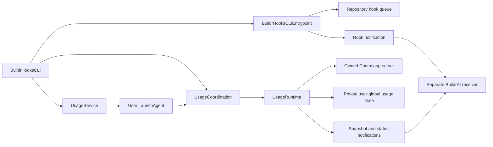

# BuildrHooksCLI Architecture

BuildrHooksCLI owns two independent paths in the same Swift 6.2/macOS 26 package:
repository-local Codex/Claude hook relay and explicitly enabled account usage
collection. BuildrAI owns project selection, hook configuration, notification receipt,
widget storage, and display. The CLI never writes BuildrAI's App Group.

## Modules and entrypoints

`BuildrHooksCLI` is the ArgumentParser executable. Its hook commands call
`BuildrHooksCLIEntrypoint`; `usage` commands call `UsageRuntime`, with
`UsageCoordination` for exclusive ownership and private command delegation, and
`UsageService` for user LaunchAgent management. `BuildrHooksCore` implements these
paths with injected clocks, provider transport, storage, notifier and output boundaries.
Usage failures cannot change hook ingestion or Prompt Gate exits.

## Repository hooks

Both `codex` and `claude` expose `session-start`, `prompt-submit`, `stop`, and
`tool-start`. `BuildrHooksCLIEntrypoint` validates the agent/event command, reads stdin,
resolves the repository root, and chooses the agent-specific factory. Root discovery
walks upward to `.git`, falling back to the invocation directory.

Lifecycle factories produce `RawHookEvent` with source, event kind, CLI receipt time,
repository/working directory, structured session/transcript/model fields and the
original valid UTF-8 payload. Codex declared execution surfaces come from matching
hook-declared transcript metadata. Claude declares a Desktop surface only when its
matching transcript's latest entrypoint is `claude-desktop`; missing or conflicting
evidence leaves the surface absent. The host owns Claude settings as recorded in
[ADR 0001](docs/adr/0001-keep-claude-hook-management-in-the-host.md).

Tool-start factories produce a separate versioned, content-free event for an observed
attempt, including denied/failed attempts. They retain source-provided session and tool
name, optional invocation/subagent identity and declared surface, and exclude tool
input, arguments, command text and output. Codex's supplied parent session identity is
preserved; Claude's per-call `agent_id` is carried separately when available. See
[ADR 0002](docs/adr/0002-content-free-tool-start-events.md).

`RawHookEventQueue` atomically writes ISO-8601 JSON under
`<repo>/.buildrai/inbox/raw-hooks`, with timestamp/UUID filenames. It also creates
`.buildrai/archive/raw-hooks-processed`; BuildrAI owns consumption and archiving.
The executable supplies its version for the best-effort
`.buildrai/bridge-cli-version.json` marker after a successful enqueue. The marker
records the version that last handled a hook, so it can lag an installed upgrade.
`ai.buildrai.hook-event-enqueued` carries the repository root path. Usage notifications
have their own names and schema and never repurpose this hook notification.

Parsing/persistence failures are warnings and remain best-effort for ordinary hooks.
Unsupported command shapes throw a caller error. Tool-start telemetry cannot decide
whether a tool may run.

## Prompt Gate

Only Codex `prompt-submit` with a standalone `#BuildrAI-Eval` line enters the blocking
Prompt Gate path. Claude prompts and ordinary hooks do not. The strict parser removes
recognized tag lines, ignores prose/fenced examples, rejects empty evaluated prompts,
and bounds evaluated prompts to 6000 characters before creating requests.

The repository marker `.buildrai/hooks/prompt-gate.json` contains version/enabled and
optional project/path/setup metadata. Missing/disabled markers exit 13;
malformed/unsupported markers exit 14. Untagged prompts ignore the marker.
`PromptGateFileBridge` creates `.buildrai/hooks/prompt-eval/inflight.lock` exclusively,
rejects symlinked paths, atomically writes `request.json`, and waits for a matching
version 1 `response.json`. The request carries exact original/evaluated prompts and
context for evaluation. Allow cleans owned handshake files and continues the queue;
deny exits 10, busy 11, timeout 12, and invalid/mismatched response 16. Blocking failures
never enqueue a normal event. Evaluator policy remains the host's responsibility.

## Account usage runtime

The additive `usage refresh`, `watch`, `clear`, and `service enable/disable/status`
commands require explicit Codex selection for collection and clear. Claude usage is
reserved but unsupported. Capability schema 1 advertises both hook agents, both
content-free tool-start producers, Codex refresh/watch/clear/service and usage schema 1.

`CodexUsageFetcher` owns a persistent app-server stdio connection in watch and an
owned temporary connection for one-shot collection. Codex handles authentication;
the CLI never reads credential files or forces login. Initialization, account read,
and full limits read share a thirty-second fetch deadline. Sparse provider events
request a full read. Startup/wake request collection; polling runs every five minutes.
Every successful usable full fetch updates collection time, even for unchanged values.
Starts are spaced by thirty seconds; temporary failures retry exponentially with jitter,
capped at five minutes. Longer provider retry restrictions win and persist across clear,
connection loss and restart. Authentication failures wait for an auth event or scheduled
check. Missing limits report unavailable usage, retaining verified older observations.

`UsageRuntime` is the primary test seam for collection, triggers, recovery and clear.
Recovery verification/reply throttling, lifecycle callback flags, and service output
buffers use `Synchronization.Mutex` with checked `Sendable` state. Signal sources and
notification observer tokens stay with the synchronous command owner; callbacks
capture only the protected lifecycle state. The collector loop and process I/O remain
synchronous, including their cancellation and shutdown deadlines.
Normalized windows preserve actual bucket codes, roles, percentages, duration/reset
when known; missing data remains absent, values above 100 remain valid and credits are
excluded. Snapshot/status streams remain separate. The shared schema, redaction and
validation rules are in [account usage wire](docs/account-usage-wire.md).

## Ownership, persistence and recovery

`UsageCoordination` serializes watch, one-shot refresh and clear through one per-user
exclusive lock. A second watch exits; refresh/clear delegate over the owner-only Unix
socket beside the cache, with peer-user checks and bounded version 1 frames/deadlines.
Only the lock owner removes stale sockets. The lock file remains to prevent independent
locked inodes; cleanup removes only the socket inode created by that owner.

`UsageFileStateStore` retains minimal observations/status, revisions, retry restrictions,
and salted fingerprints at `~/.codex/buildr-artifacts/account-usage.json`. Writes use an
owner-only temporary file, synchronization, atomic rename, and directory synchronization.
A partial temporary write cannot replace committed state. Invalid ordering fails closed;
corrupt state is not silently replaced with revision zero. Clear/account change commits
invalidation before publication and never resets ordering. A fetch reloads committed
revision after the provider boundary and discards superseded or cancelled results.
Interrupted publication leaves committed state available for later recovery.

Recovery requests carry no userInfo and coalesce globally to once per second. They do
not fetch limits or bypass throttling. Before restart replay, an optional bounded Codex
routing identity must match the private fingerprint. Missing identity withholds cache
until a fresh usable observation; sparse auth events/connection loss revoke session
proof. Replay preserves original times/revisions and includes invalidation without a
snapshot. Account fingerprints and raw identities never enter public payloads/logs.

## Enabled service and shutdown

Explicit enable validates stable CLI/Codex paths and writes a user LaunchAgent directly
running `usage watch`. `RunAtLoad` starts immediately and at login; `KeepAlive` restarts
exits while loaded, and `ThrottleInterval` enforces at least thirty seconds between launchd spawn attempts.
Restart reacquires the same exclusive lock and performs account verification, retaining
provider configuration and persisted retry restrictions. Codex reconnection additionally
uses the runtime's bounded failure retry policy.

Disable removes the startup plist then uses `bootout` to remove the job and its restart
policy. Inspection, removal and ownership waiting share a five-second budget. SIGTERM
cancels work, including recovery identity reads; late full results are withheld. The
owned Codex child receives closed stdin/SIGTERM and up to four seconds of grace, then
SIGKILL if needed, reserving one second inside the parent shutdown deadline. `ExitTimeOut` bounds launchd's collector shutdown to five seconds;
`AbandonProcessGroup: false` additionally retains launchd cleanup of the job process
group. Foundation children need not share that group, so the collector directly
terminates its owned Codex child before the parent deadline. No discovered or unrelated
PID is signalled. Bootout failure is an
error: startup is removed, but a loaded job can still run/restart until removal succeeds.
Cache, ordering and invalidation survive disable. A foreground owner is never displaced.
The restart/shutdown keys follow the [Apple launchd plist contract](https://github.com/apple-oss-distributions/launchd/blob/main/man/launchd.plist.5).

Service diagnostics separate saved configuration, loaded job, running process, bounded
endpoint availability and historical collection status. `processHealth` reports
`configured`, `enabled`, `restarting`, `unavailable` or `stopped`; these are management
diagnostics, not new notification status codes. An in-flight fetch can make a running
endpoint temporarily unavailable. Retained `ready` cannot establish process health or
freshness. JSON stdout excludes identity/paths; redacted diagnostics use stderr.

## BuildrAI integration and evidence

BuildrAI separately owns untrusted notification validation, independent snapshot/status
revision floors, durable invalidation and atomic widget storage. Values become stale at
fifteen minutes without changing collection time. Window closing keeps its receiver
active; Quit/Command-Q fully exits BuildrAI, while the independently enabled collector
continues. Offline clear eventually reconciles when both sides become available for
recovery; no notification queue, receipt acknowledgement or immediate offline widget
clearing is promised.

Simulated provider/process/service adapters and notifier spies prove contracts and
committed state, not macOS delivery. Pending real-receiver checks are documented in
[account usage wire](docs/account-usage-wire.md). Ordinary tests install no LaunchAgent,
use no live credentials, and add no runtime probe. Sender distribution must support
unsandboxed userInfo payloads; no App Store approval guarantee is claimed.
